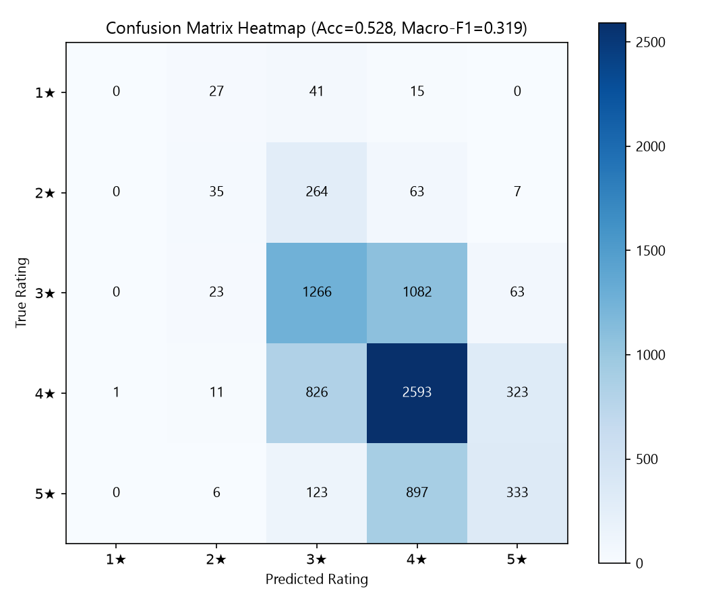
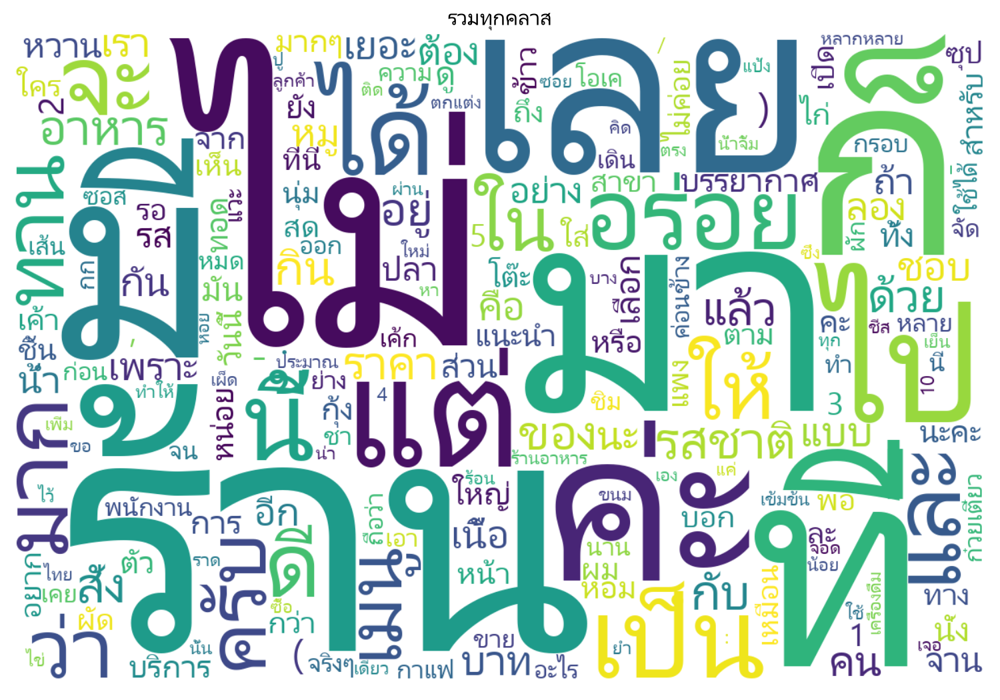
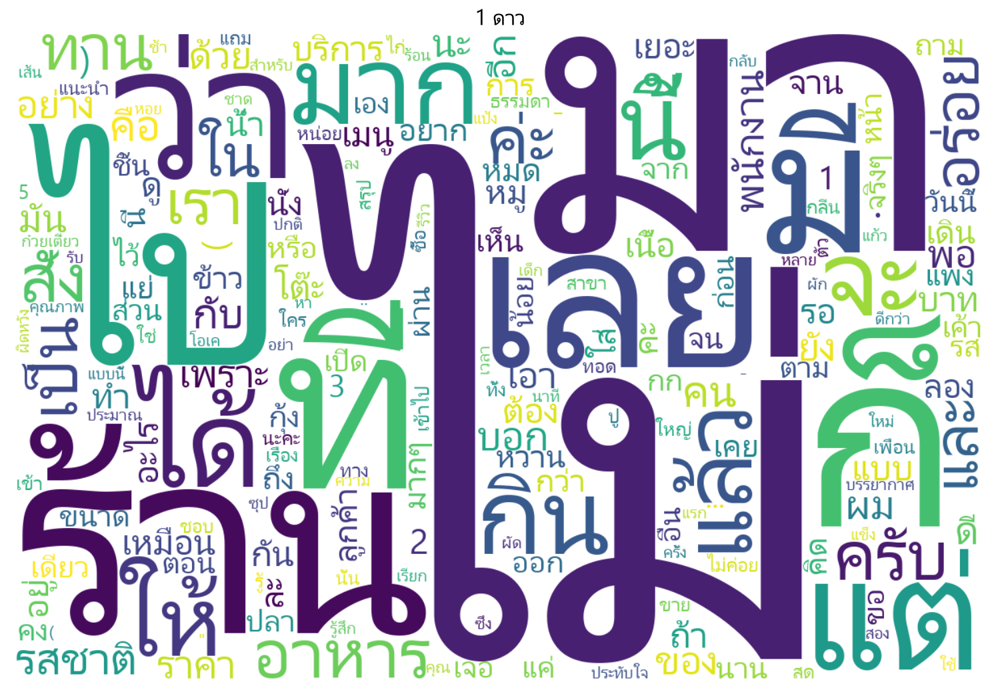
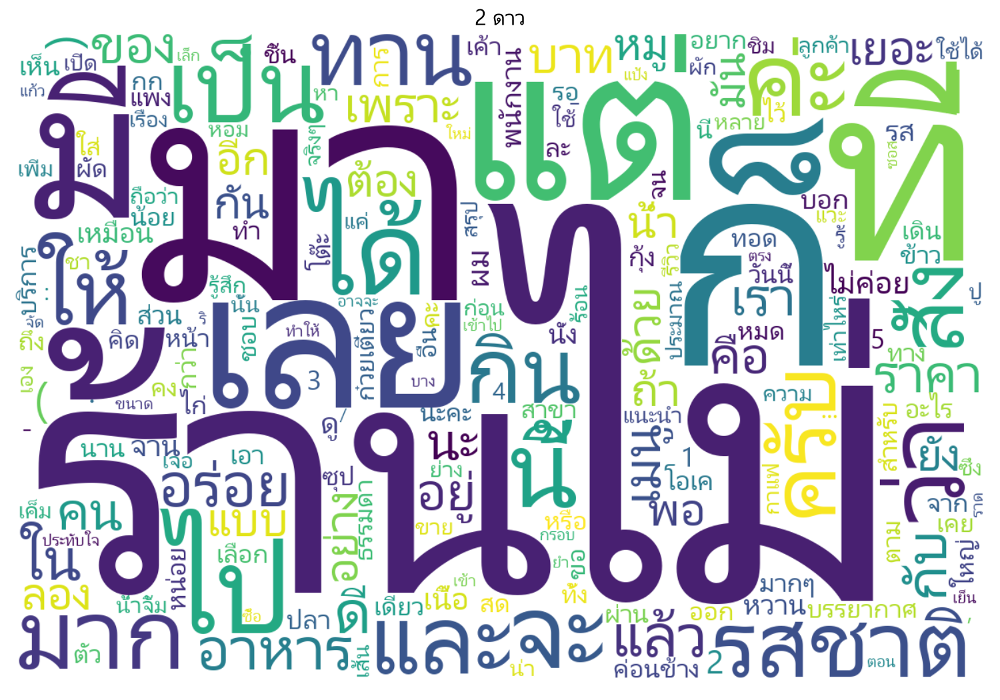
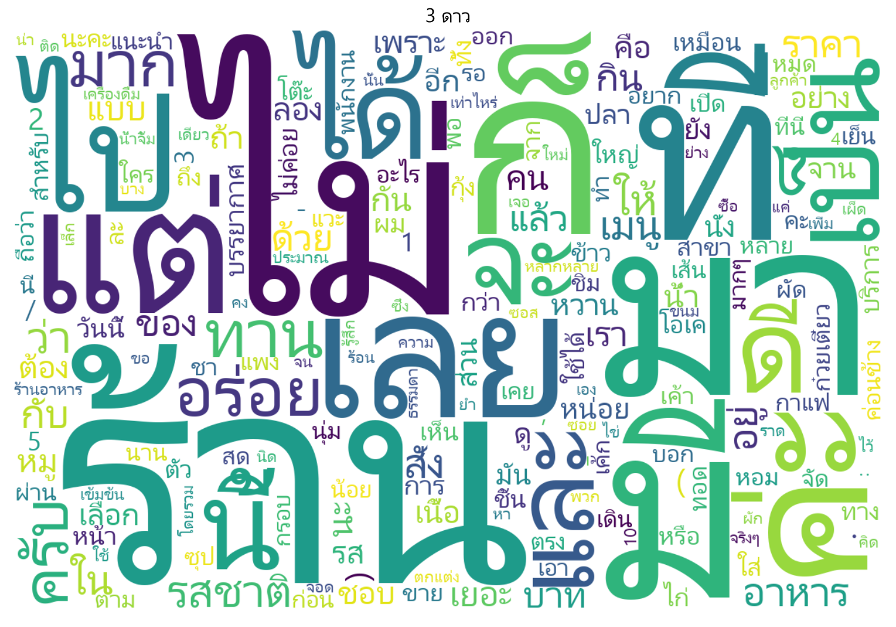
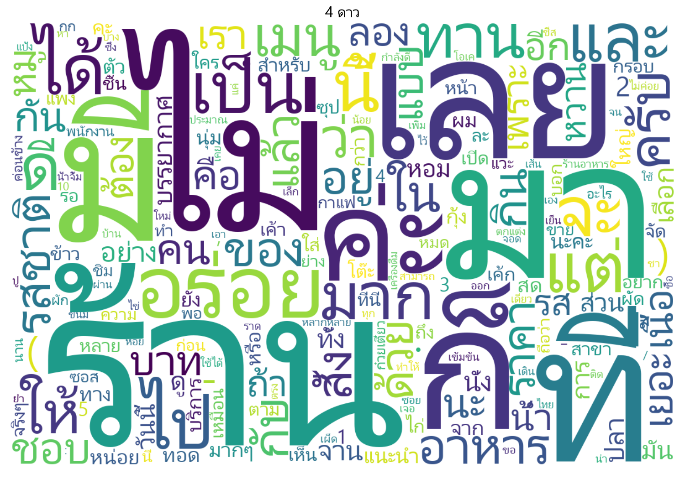
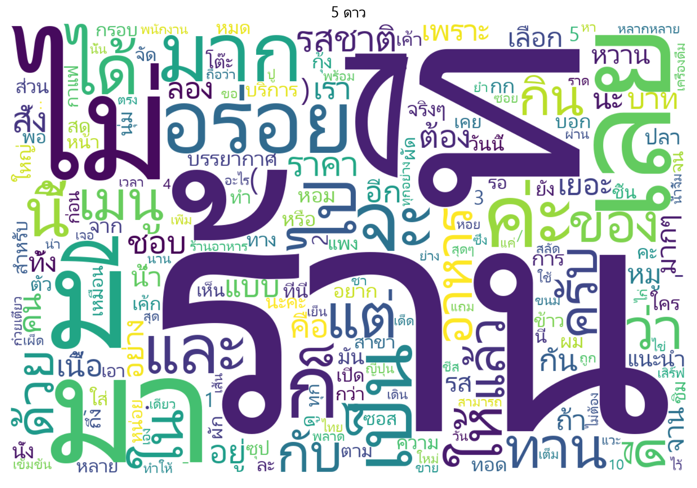

# Week 7 — Wongnai Reviews: Thai Naive Bayes + Laplace Smoothing (Results Summary)

## 1. Accuracy & Per-Class Performance Metrics (Stratified 80/20 Validation Split: 7,999 Reviews)

- **Overall Validation Accuracy:** **`52.84%`** (`0.5284`)
- **Macro-F1 Score:** **`31.92%`** (`0.3192`)
- **Vocabulary Size (`VOCAB`):** `52,636` unique tokens (tokenized via `pythainlp.tokenize.longest`)
- **Laplace Smoothing:** $\alpha = 1.0$

| Rating Class | Support (Validation) | Precision | Recall | F1-Score |
| :--- | ---: | ---: | ---: | ---: |
| **1★** | 83 | 0.0000 | 0.0000 | 0.0000 |
| **2★** | 369 | 0.3431 | 0.0949 | 0.1486 |
| **3★** | 2,434 | 0.5024 | 0.5201 | **0.5111** |
| **4★** | 3,754 | 0.5576 | 0.6907 | **0.6171** |
| **5★** | 1,359 | 0.4587 | 0.2450 | 0.3194 |

---

## 2. Test-Set Predictions (`predictions.csv` — 6,203 Unlabeled Reviews)

| Predicted Rating | Count | Percentage |
| :--- | ---: | ---: |
| **1★** | 0 | 0.00% |
| **2★** | 45 | 0.73% |
| **3★** | 1,888 | 30.44% |
| **4★** | 3,790 | 61.10% |
| **5★** | 480 | 7.74% |
| **Total** | **6,203** | **100.00%** |

---

## 3. Visualizations (`figures/`)

### Confusion Matrix Heatmap

### Word Clouds (All Classes + 1★ to 5★)
- **รวมทุกคลาส (`all`):** 
- **1 ดาว (`1★`):** 
- **2 ดาว (`2★`):** 
- **3 ดาว (`3★`):** 
- **4 ดาว (`4★`):** 
- **5 ดาว (`5★`):** 
